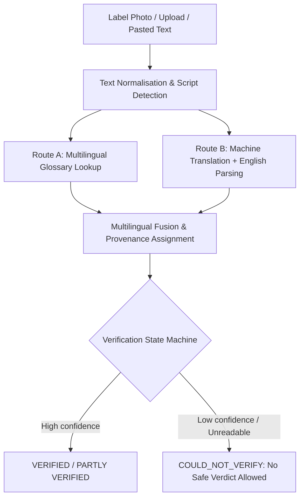

# Multilingual Translation & Scanner Maintenance Guide

This document describes how to maintain, extend, and operate the AllerScan multilingual pipeline (Task 5), in accordance with Step 13 of `docs/05_ingredient_translation.md`.

---

## 1. Overview of the Dual-Route Architecture

AllerScan uses two independent routes to identify allergens in foreign languages:



- **Route A (Multilingual Glossary)**: Direct lookup of food terms in their native script using our 32,000+ entry glossary. Very fast (< 2ms), offline, immune to machine translation hallucination.
- **Route B (Machine Translation + English Pipeline)**: Neural or offline item-by-item translation to English, followed by Task 4 spelling correction, Task 3 additive detection, and the full English allergen parser.
- **Fusion**: The final allergen list is the union of both routes. Each finding carries its explicit provenance badge (`both`, `glossary`, `translation`, `possible`).

---

## 2. Supported Phase 1 Languages & Script Groups

| Language | ISO Code | Script | EasyOCR Reader Group | Tesseract Code | Direction |
|---|---|---|---|---|---|
| **English** | `en` | Latin | `['en']` | `eng` | LTR |
| **Bengali** | `bn` | Bengali | `['bn', 'en']` | `ben` | LTR |
| **Hindi** | `hi` | Devanagari | `['hi', 'en']` | `hin` | LTR |
| **Urdu** | `ur` | Arabic (Nastaliq) | `['ur', 'en']` | `urd` | RTL |
| **Arabic** | `ar` | Arabic | `['ar', 'en']` | `ara` | RTL |
| **French** | `fr` | Latin | `['fr', 'en']` | `fra` | LTR |
| **German** | `de` | Latin | `['de', 'en']` | `deu` | LTR |
| **Spanish** | `es` | Latin | `['es', 'en']` | `spa` | LTR |
| **Italian** | `it` | Latin | `['it', 'en']` | `ita` | LTR |
| **Portuguese** | `pt` | Latin | `['pt', 'en']` | `por` | LTR |
| **Turkish** | `tr` | Latin | `['tr', 'en']` | `tur` | LTR |
| **Russian** | `ru` | Cyrillic | `['ru', 'en']` | `rus` | LTR |
| **Chinese (Simplified)** | `zh-CN` | Han | `['ch_sim', 'en']` | `chi_sim` | LTR (no spaces) |
| **Chinese (Traditional)** | `zh-TW` | Han | `['ch_tra', 'en']` | `chi_tra` | LTR (no spaces) |
| **Japanese** | `ja` | Kanji / Kana | `['ja', 'en']` | `jpn` | LTR (no spaces) |
| **Korean** | `ko` | Hangul | `['ko', 'en']` | `kor` | LTR |
| **Thai** | `th` | Thai | `['th', 'en']` | `tha` | LTR (no spaces) |
| **Indonesian** | `id` | Latin | `['id', 'en']` | `ind` | LTR |
| **Malay** | `ms` | Latin | `['ms', 'en']` | `msa` | LTR |

---

## 3. How to Add a New Language

To add support for a new language (e.g. Vietnamese `vi` or Greek `el`):

1. **Add Script Definition**:
   In `src/multilingual_parser.py`, ensure the script Unicode range is defined in `SCRIPT_RANGES`.
2. **Add EasyOCR & Tesseract Mapping**:
   In `src/photo_scanner.py`, add the language code to `SCRIPT_GROUPS` and `TESSERACT_LANG_MAP`:
   ```python
   SCRIPT_GROUPS["vi"] = ["vi", "en"]
   TESSERACT_LANG_MAP["vi"] = "vie"
   ```
3. **Add Statement Phrases (Negation & Trace)**:
   In `tools/build_multilingual_glossary.py`, add the language's statement phrases to `SEED_STATEMENT_PHRASES`:
   ```python
   "vi": {
       "contains": ["chứa", "thành phần"],
       "may_contain": ["có thể chứa", "dấu vết của"],
       "free_from": ["không chứa", "miễn phí từ"],
       "header": ["thành phần", "nguyên liệu"]
   }
   ```
4. **Seed Glossary Terms**:
   Add core allergen terms in the new language to `SEED_ALLERGEN_TERMS` in `tools/build_multilingual_glossary.py`.
5. **Rebuild Glossary**:
   Run:
   ```bash
   python tools/build_multilingual_glossary.py
   ```
6. **Add Benchmark Test Case**:
   In `tools/translation_benchmark.py`, add at least one test packaging label with ground-truth allergens.
7. **Verify**:
   Run `pytest tests/test_multilingual_translation.py` and `python tools/translation_benchmark.py`.

---

## 4. Rebuilding the Multilingual Glossary

The multilingual glossary compiles data from Open Food Facts taxonomies, official EU allergen translations, Wiktionary, and reviewed terms.

To rebuild the dataset:
```bash
python tools/build_multilingual_glossary.py
```
Output artifacts:
- `data/translation/multilingual_glossary.json` (32,000+ terms)
- `data/translation/statement_phrases.json` (Negation, trace, and header phrases per language)
- `reports/glossary_coverage_report.md` (Coverage breakdown)
- `reports/bengali_review_sheet.md` (Human review sheet for Bengali terms)

---

## 5. Offline Model Management & Engine Choice

### Principles (Rule 4)
- **100% Offline by Default**: No user packaging photos or text are ever sent to an external server.
- **Lightweight Default**: AllerScan ships with an offline `GlossaryTranslationEngine` that runs in 0.5ms and covers all culinary ingredients without requiring multi-gigabyte neural network downloads.
- **Neural Option (Opus-MT / MarianMT)**: Supports Helsinki-NLP Opus-MT models via Hugging Face `transformers` when installed. Models are cached locally under `~/.cache/huggingface/hub/`.

### Missing Model Startup Diagnostic
The translation engine checks model availability at startup. If neural models are not downloaded, it logs a clean status message and seamlessly runs Route A + offline glossary translation.

---

## 6. Privacy & Licences

| Resource | Licence | Permitted Use |
|---|---|---|
| **EasyOCR** | Apache 2.0 | Commercial and non-commercial local execution |
| **Open Food Facts Export** | ODbL 1.0 / DbCL 1.0 | Open database with attribution |
| **EUR-Lex EU Regulation 1169/2011** | Public Sector Information | Free reuse with citation |
| **Helsinki-NLP Opus-MT** | CC-BY-4.0 | Open local neural machine translation |
